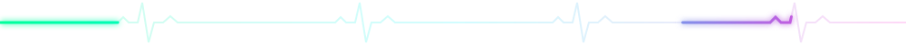
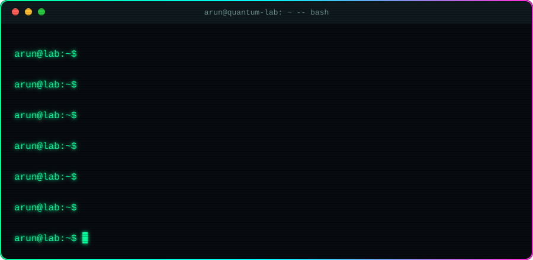
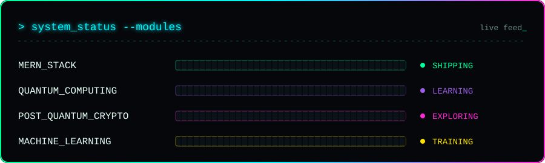

<!-- ═══════════════════════════════════════════════════════════════ -->
<!--        ARUN ULAGAPPAN :: CYBER PROFILE  //  root@github        -->
<!-- ═══════════════════════════════════════════════════════════════ -->

<div align="center">



<a href="https://github.com/ArunUlagappan">
  
</a>




<br/>

<a href="https://github.com/ArunUlagappan">
  
</a>
<a href="https://github.com/ArunUlagappan?tab=followers">
  
</a>

<br/><br/>



</div>

<br/>

## `[01]` &nbsp;`> ./about_me.sh`

<div align="center">
  
</div>

<br/>

```diff
+ ROLE      : Computer Science Engineering Student 
+ CAMPUS    : MIT Campus, Anna University
+ PRIMARY   : MERN full-stack development
+ EXPLORING : Quantum Computing | Post-Quantum Cryptography | Machine Learning
+ MINDSET   : Build | Learn | Experiment | Collaborate
- BUGS      : (segfault) ...fixing
```

```text
        |ψ⟩  =  α |build⟩  +  β |learn⟩  +  γ |experiment⟩
        ───────────────────────────────────────────────────
        Until observed, I exist in a superposition of all three.
```

> *Curiosity drives the question. Engineering builds the answer.*

---

## `[02]` &nbsp;`> sudo ./load_modules.sh`

<div align="center">
  
</div>

---

## `[03]` &nbsp;`> cat ./tech_arsenal`

<div align="center">

**// LANGUAGES**<br/>


**// FULL-STACK**<br/>


**// TOOLS & DEPLOY**<br/>


**// CREATIVE**<br/>


</div>

---

## `[04]` &nbsp;`> ls ~/projects`

<div align="center">

<!-- 👇 REPLACE YOUR-REPO-1..4 with your REAL repository names (delete cards you don't need) -->
<a href="https://github.com/ArunUlagappan/YOUR-REPO-1"></a>
<a href="https://github.com/ArunUlagappan/YOUR-REPO-2"></a>
<a href="https://github.com/ArunUlagappan/YOUR-REPO-3"></a>
<a href="https://github.com/ArunUlagappan/YOUR-REPO-4"></a>

<br/>

<a href="https://github.com/ArunUlagappan?tab=repositories">
  
</a>

</div>

---

## `[05]` &nbsp;`> ./github_telemetry --live`

<div align="center">


<br/><br/>


<br/><br/>


</div>

---

## `[06]` &nbsp;`> ./snake.exe --eat-contributions`

<div align="center">
  
</div>

---

## `[07]` &nbsp;`> ./achievements --unlocked`

<div align="center">
  
</div>

---

## `[08]` &nbsp;`> ssh arun@collab`

<div align="center">



<br/>

<a href="mailto:sarunulagappan@gmail.com"></a>
<a href="https://www.linkedin.com/in/arunulagappan2024/"></a>
<a href="https://www.instagram.com/the__great__rex/"></a>
<a href="https://github.com/ArunUlagappan"></a>

<br/><br/>


</div>

<br/>

<details>
<summary><b>🔓 [CLASSIFIED] click to decrypt hidden file</b></summary>

<br/>

```bash
$ echo "01000001 01110010 01110101 01101110" | decode --binary
> ??? (hint: it's my first name)

$ sudo rm -rf boredom/
> permission granted. boredom deleted.

$ python3 -c "import quantum; print('Schrodinger\'s bug: both fixed and broken')"
> Schrodinger's bug: both fixed and broken
```

*P.S. If you read this far, we should definitely build something together.* 🚀

</details>

<div align="center"><sub><code>// designed with curiosity · powered by code · driven by collaboration //</code></sub></div>
